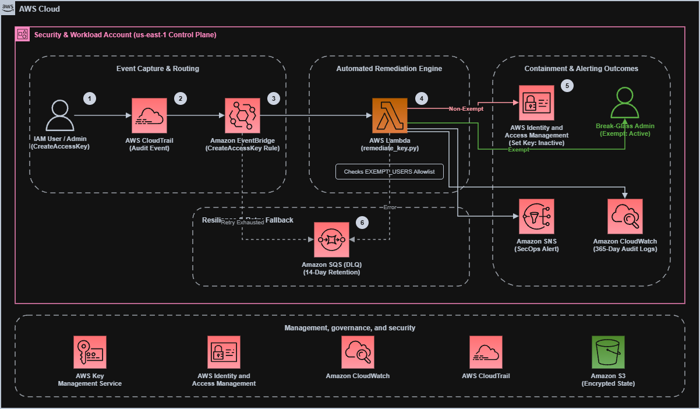

cat << 'EOF' > README.md
# Event-Driven Threat Detection & Automated IAM Access Key Remediation


An automated cloud security containment pipeline built with modular **Terraform** and **Python 3.12** that detects `iam:CreateAccessKey` API calls in near real time and revokes unauthorized long-lived IAM credentials in under 5 seconds—while preserving approved break-glass identities and enforcing defense-in-depth encryption and least privilege.

---

## Table of Contents

1. [Security Problem & Threat Model](#security-problem--threat-model)
2. [System Architecture](#system-architecture)
3. [Deep-Dive: End-to-End Execution Flow](#deep-dive-end-to-end-execution-flow)
4. [Remediation Logic & Edge-Case Handling (`remediate_key.py`)](#remediation-logic--edge-case-handling-remediate_keypy)
5. [Defense-in-Depth Security Controls](#defense-in-depth-security-controls)
6. [Repository Structure](#repository-structure)
7. [Compliance & Framework Mapping](#compliance--framework-mapping)
8. [Local Deployment & Verification with Floci](#local-deployment--verification-with-floci)
9. [Architectural Trade-Offs (Preventive vs. Detective)](#architectural-trade-offs-preventive-vs-detective)

---

## Security Problem & Threat Model

In AWS, **IAM User Access Keys** (`AKIA...`) are static, long-lived programmatic credentials that do not expire automatically.

* **Attack Vector:** If an engineer creates a static access key and accidentally pushes it to a public repository, CI log, or developer workstation, automated credential harvesters can compromise the AWS account within minutes.
* **Limitation of Periodic Audits:** Scheduled compliance scanners (such as nightly AWS Config rules or weekly cron audits) leave a multi-hour exposure window during which an attacker can exfiltrate data or escalate privileges.
* **Automated Containment Objective:** Intercept every `CreateAccessKey` control-plane mutation immediately via event-driven automation, evaluate the target identity against an explicit allowlist, deactivate unauthorized keys (`Status = Inactive`) in under 5 seconds, and emit tamper-evident forensic telemetry.

---

## System Architecture



---

## Deep-Dive: End-to-End Execution Flow

1. **Control-Plane API Capture (`AWS CloudTrail` in `us-east-1`):**
   IAM is a global AWS service whose management events are recorded in the `us-east-1` control plane. When any principal invokes `iam:CreateAccessKey`, CloudTrail records a management write event containing `userIdentity` (the actor), `requestParameters` (the requested target user), and `responseElements` (the newly minted `accessKeyId` and `userName`).
2. **Real-Time Event Filtering (`Amazon EventBridge`):**
   Rather than waiting up to 15 minutes for CloudTrail log file delivery to S3, EventBridge evaluates the management event stream in near real time. A dedicated rule filters strictly on `source: ["aws.iam"]`, `detail-type: ["AWS API Call via CloudTrail"]`, `detail.eventSource: ["iam.amazonaws.com"]`, and `detail.eventName: ["CreateAccessKey"]`.
3. **Allowlist Evaluation & Key Revocation (`AWS Lambda` — Python 3.12):**
   EventBridge invokes the `iam-access-key-remediator` Lambda function (`remediate_key.py`). The function parses the nested CloudTrail payload, extracts the target username and `accessKeyId`, and checks membership against the `EXEMPT_USERS` allowlist:
   * **Non-Exempt Identity (Default Deny):** Calls `iam:UpdateAccessKey(UserName=..., AccessKeyId=..., Status="Inactive")` to neutralize the credential immediately while preserving forensic audit history, then publishes a `HIGH` severity JSON incident alert to Amazon SNS.
   * **Exempt Break-Glass Identity (`breakglass-admin`):** Leaves the key `Active` to prevent administrative lockout during emergencies and emits a `MEDIUM` severity audit notice to CloudWatch Logs and SNS.
4. **Fault Tolerance & Zero Event Loss (`Amazon SQS Dead-Letter Queue`):**
   Both the EventBridge target rule (configured with 3 retries over 1 hour) and the Lambda function's asynchronous `dead_letter_config` point to a KMS-encrypted SQS Dead-Letter Queue (`14-day` message retention). If IAM API throttling or transient runtime errors occur, the raw CloudTrail event is preserved for replay and investigation.
5. **Cryptographic & Forensic Telemetry (`AWS KMS`, `CloudWatch Logs`, `Amazon SNS`):**
   Every log stream, notification payload, queue message, and Lambda environment variable is encrypted at rest using a dedicated Customer Managed Key (CMK) with automatic 365-day key rotation enabled.

---

## Remediation Logic & Edge-Case Handling (`remediate_key.py`)

Real-world CloudTrail payloads vary depending on how `CreateAccessKey` is invoked. The Python handler explicitly handles three critical edge cases:

1. **Self-Service Key Creation (`requestParameters` is `null`):**
   When a user runs `aws iam create-access-key` without specifying `--user-name`, AWS sets `detail.requestParameters` to `null` and places the target identity inside `detail.responseElements.accessKey.userName` and `detail.userIdentity.userName`. The handler resolves the target user across `responseElements` -> `requestParameters` -> `userIdentity` so self-service keys cannot bypass detection.
2. **Failed API Calls (`errorCode` Present in CloudTrail):**
   If an unauthorized caller attempts `CreateAccessKey` and receives an `AccessDenied` error from IAM, `responseElements` is `null` because no key was minted. The handler detects `errorCode` / missing `accessKeyId`, logs an `IGNORED_FAILED_API_CALL` audit record, and exits cleanly without triggering false-positive errors into the DLQ.
3. **Structured JSON Forensics:**
   Every invocation emits single-line structured JSON logs (`action`, `severity`, `target_user`, `access_key_id`, `actor_arn`, `source_ip`, `event_time`) ready for direct ingestion into CloudWatch Logs Insights, Amazon Security Lake (OCSF), or an external SIEM.

---

## Defense-in-Depth Security Controls

* **Customer Managed KMS Key (`kms.tf`):** Single-tenant CMK with `enable_key_rotation = true` (annual rotation) and a scoped key policy granting cryptographic permissions exclusively to the account root, CloudWatch Logs, SNS, SQS, and the Lambda execution role.
* **Zero-Wildcard Least-Privilege IAM (`iam.tf`):** The Lambda execution role has zero `"Resource": "*"` statements—`iam:UpdateAccessKey` and `iam:ListAccessKeys` are scoped to `arn:aws:iam::<account_id>:user/*`, `sns:Publish` is scoped to the specific SecOps topic ARN, and `sqs:SendMessage` is scoped to the specific DLQ ARN.
* **IAM Permission Boundary (`iam.tf`):** An explicit `permissions_boundary` is attached to the Lambda execution role, establishing an upper ceiling on maximum effective permissions even if an inline policy were later modified.
* **Blast-Radius & Concurrency Guardrails (`main.tf`):** `reserved_concurrent_executions = 10` prevents runaway recursion or account-wide Lambda concurrency exhaustion during an API burst.

---

## Repository Structure

```text
iam-remediation/
├── architecture.png     # Official AWS-icon reference architecture diagram
├── backend.tf           # Production S3 encrypted state backend with native state locking
├── providers.tf         # AWS provider configuration (us-east-1) and compliance default tags
├── override.tf          # Local Floci emulator endpoint overrides (http://localhost:4566)
├── variables.tf         # Configurable parameters (environment, allowlist, retention) with validation
├── kms.tf               # KMS Customer Managed Key (CMK) and least-privilege key policy
├── iam.tf               # Lambda execution role, scoped policies, and IAM Permission Boundary
├── observability.tf     # KMS-encrypted CloudWatch Log Group, SNS alert topic, and SQS DLQ
├── main.tf              # Python archive packaging, Lambda function, and EventBridge rule/target
├── outputs.tf           # Exported ARNs, function name, and SQS DLQ URL
└── src/
    └── remediate_key.py # Python 3.12 event parser, allowlist evaluator, and IAM containment handler
